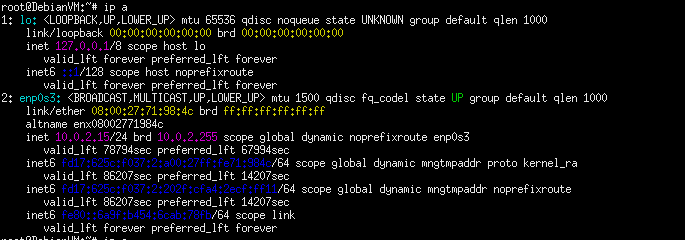
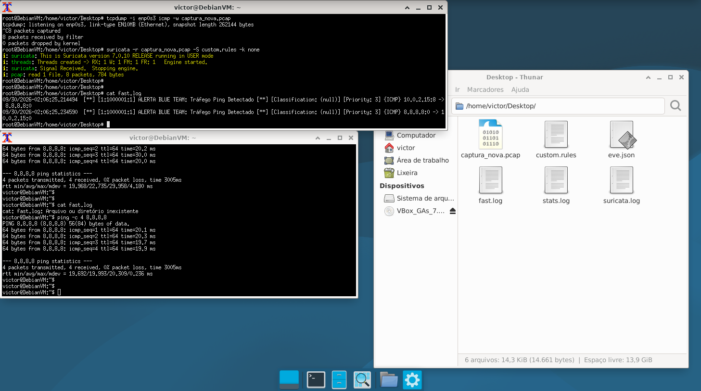
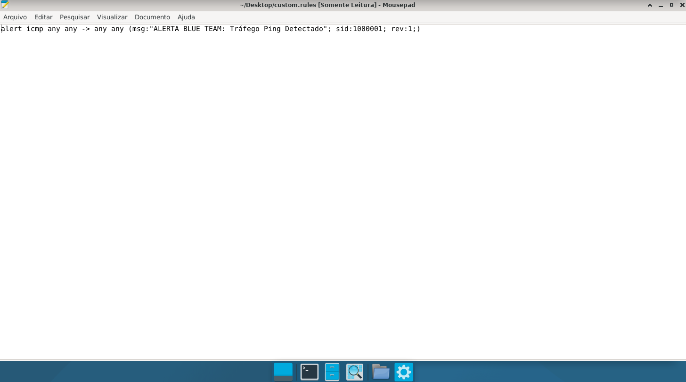
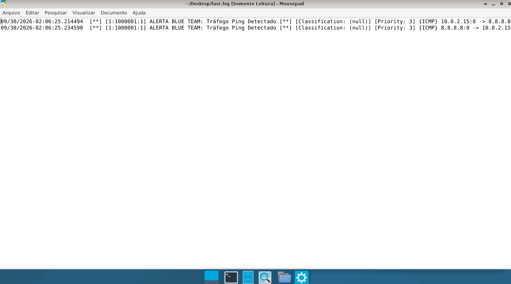
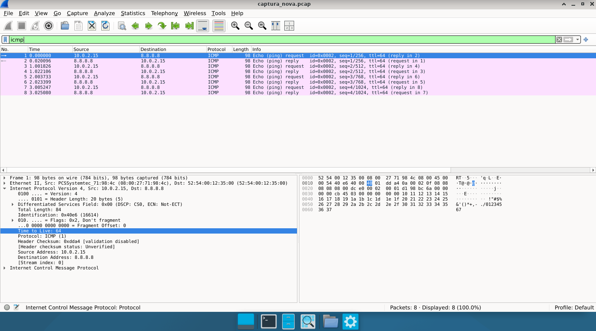

#Português

Relatório Técnico: Engenharia de Detecção e Validação de Regras NIDS com Suricata - Simulação

1. Reconhecimento e Identificação de Interfaces de Rede

Antes de iniciar qualquer operação de captura ou monitoramento em um ambiente Linux (`Debian 13`), realizou-se a triagem das interfaces de rede ativas por meio do comando `ip a`. Esta etapa é crítica para direcionar ferramentas de sniffing à interface correta. 
* Interface `lo` (Loopback): Endereçada internamente (`127.0.0.1`), é utilizada exclusivamente pelo kernel para comunicação de processos locais dentro da máquina virtual. Não possui visibilidade de tráfego externo. 
* Interface `enp0s3` (Ethernet Network Port): Interface de rede primária da VM (configurada via NAT com o IP local `10.0.2.15`). É o ponto de trânsito obrigatório para toda a telemetria direcionada à rede externa. 
* Decisão Operacional: O direcionamento do `tcpdump` foi fixado estritamente na interface `enp0s3` para garantir a captação do tráfego real de rede.

2. Escopo da Simulação

Este exercício documenta a configuração de um ambiente de testes isolado para validar a mecânica de um Sistema de Detecção de Intrusões (NIDS). O objetivo é demonstrar a capacidade de capturar tráfego de rede bruto, desenvolver assinaturas de detecção (regras) customizadas e validar o acionamento do motor analítico (`Suricata`) através de logs correlacionados.

3. Topologia e Ferramentas

* Ambiente: `Debian 13` 
* Interface de Rede: `enp0s3` (virtual machine)
* Ferramentas: `tcpdump`, `Suricata` e `Wireshark`.

4. Execução e Coleta de Dados

Para simular o tráfego que acionaria o alarme, foi estabelecida uma captura controlada de pacotes ICMP.
* 1. O utilitário `tcpdump` foi inicializado para escutar a interface `enp0s3`, formatando a saída para um arquivo com cabeçalhos Ethernet corretos `captura_nova.pcap`.
* 2. A linha de base foi gerada disparando requisições "Echo Request" para o endereço de destino `8.8.8.8`.

5. Engenharia da Regra de Detecção

Uma assinatura customizada foi elaborada para identificar especificamente qualquer pacote do protocolo ICMP transitando na rede, em qualquer direção.
* Arquivo de configuração: `custom.rules`
* Sintaxe da Assinatura: 
        `alert icmp any any -> any any (msg:"ALERTA BLUE TEAM: Tráfego Ping Detectado"; sid:1000001; rev:1;)`

* Parâmetros Técnicos: Ação configurada para gerar alerta, abrangendo IPs e portas de origem e destino irrestritos (`any any -> any any`). Foi atribuído um Signature ID (SID) para uso interno `1000001`.

6. Processamento e Análise de Resultados

O Suricata foi executado em modo offline contra o arquivo `.pcap`, utilizando a regra customizada.

   6.1. Validação do Log (`fast.log`)
   
O Suricata processou o tráfego com sucesso. A leitura do `fast.log` confirmou o acionamento da regra mapeada:
        `[**] [1:1000001:1] ALERTA BLUE TEAM: Tráfego Ping Detectado [**]`
        

O NIDS discriminou adequadamente os fluxos da conexão, alertando tanto a saída `10.0.2.15:8 -> 8.8.8.8:0` quanto o retorno `8.8.8.8:0 -> 10.0.2.15:0` (`VirtualBox` -> `Google`, `Google` -> `VirtualBox`).

   6.2. Análise Técnica no Wireshark
   
O arquivo de captura foi importado para o `Wireshark` para dissecação visual. O filtro `icmp` confirmou a presença exata de 8 pacotes (4 requests, 4 replies). A inspeção detalhada do cabeçalho IPv4 do pacote original validou o campo "Time to Live 64", métrica que atua como assinatura passiva característica de origens baseadas em sistemas operacionais da família `Linux`.

7. Conclusão

O laboratório demonstrou com êxito a viabilidade da cadeia de detecção. O fluxo atesta que o tráfego interceptado via CLI pode ser processado confiavelmente pelo Suricata para validação de regras, permitindo o refinamento contínuo de assinaturas e a extração estruturada de telemetria e metadados de rede. 

---

#English

Technical Report: Detection Engineering and NIDS Rule Validation with Suricata - Simulation

1. Network Interface Triaging and Identification

Before initiating any capture or monitoring operations within a Linux environment (`Debian 13`), a thorough evaluation of active network interfaces was performed via the `ip a` command. This step is critical to direct packet sniffing utilities to the correct interface.
* Interface `lo` (Loopback): Internally addressed (`127.0.0.1`), this interface is utilized exclusively by the kernel for local inter-process communication within the virtual machine. It lacks visibility into external network traffic.
* Interface `enp0s3` (Ethernet Network Port): The primary network interface of the VM (configured via NAT with the local IP `10.0.2.15`). This serves as the mandatory transit point for all telemetry directed to the external network.
* Operational Decision: The `tcpdump` deployment was strictly bound to the interface `enp0s3` to guarantee the acquisition of actual live network traffic.

2. Scope of the Simulation

This exercise documents the setup of an isolated sandbox environment to validate the internal mechanics of a Network Intrusion Detection System (NIDS). The primary objective is to demonstrate the capability to capture raw network traffic, engineer custom detection signatures (rulesets), and validate the analytical engine's trigger mechanism (`Suricata`) through correlated event logs.

3. Topology and Stack

* Environment: `Debian 13` 
* Interface of Network: `enp0s3` (virtual machine)
* Tools: `tcpdump`, `Suricata` and `Wireshark`.

4. Data Execution and Packet Acquisition

To simulate the specific traffic load that would trigger an alert, a controlled capture of ICMP packets was established.
* 1. The `tcpdump` utility was initialized to listen on the interface `enp0s3`, formatting the output into an Ethernet-compliant packet capture file `captura_nova.pcap`.
* 2. An analytical baseline was generated by firing sequential "Echo Request" queries toward the destination address `8.8.8.8`.

5. Detection Rule Engineering

A custom signature was engineered within the configuration file to explicitly identify any ICMP protocol packets traversing the network segment in any direction.
* Configuration file: `custom.rules`
* Signature Syntax: 
        `alert icmp any any -> any any (msg:"ALERTA BLUE TEAM: Tráfego Ping Detectado"; sid:1000001; rev:1;)`
* Technical Parameters: The rule action was configured to generate a real-time alert, encompassing unrestricted source and destination IPs and ports (`any any -> any any`). A unique Signature ID (SID) was assigned for internal indexing `1000001`.

6. Processing and Analytical Results

The Suricata engine was executed in offline pcap-replay mode against the `.pcap` file, utilizing the newly engineered custom rule.

   6.1. Log Validation (`fast.log`)
   
Suricata successfully processed the network traffic telemetry. A raw evaluation of the `fast.log` output confirmed the exact trigger of the mapped signature:
        `[**] [1:1000001:1] ALERTA BLUE TEAM: Tráfego Ping Detectado [**]`

The NIDS effectively discriminated bidirectional connection flows, generating distinct alerts for both the outbound egress traffic `10.0.2.15:8 -> 8.8.8.8:0` and the corresponding ingress return flow `8.8.8.8:0 -> 10.0.2.15:0` (`VirtualBox` -> `Google`, `Google` -> `VirtualBox`).

   6.2. Análise Técnica no Wireshark
   
The raw packet capture file was imported into `Wireshark` for visual dissection. The display filter `icmp` confirmed the presence of exactly 8 packets (4 requests, 4 replies). A granular inspection of the IPv4 packet headers validated the field "Time to Live 64", a reliable network metric that acts as a passive fingerprint characteristic of operating systems belonging to the `Linux` kernel family.

7. Conclusion

The laboratory experiment successfully validated the entire deployment and detection chain. The operational workflow proves that network traffic intercepted via CLI tools can be reliably processed by `Suricata` for ruleset testing, facilitating continuous signature tuning and the structured extraction of network telemetry and event metadata.
