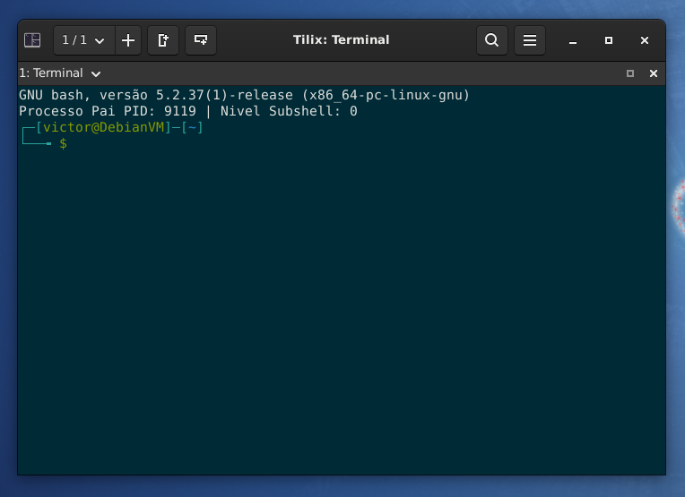
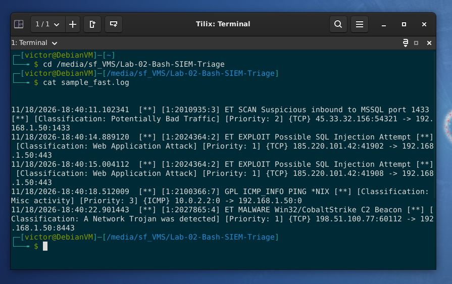
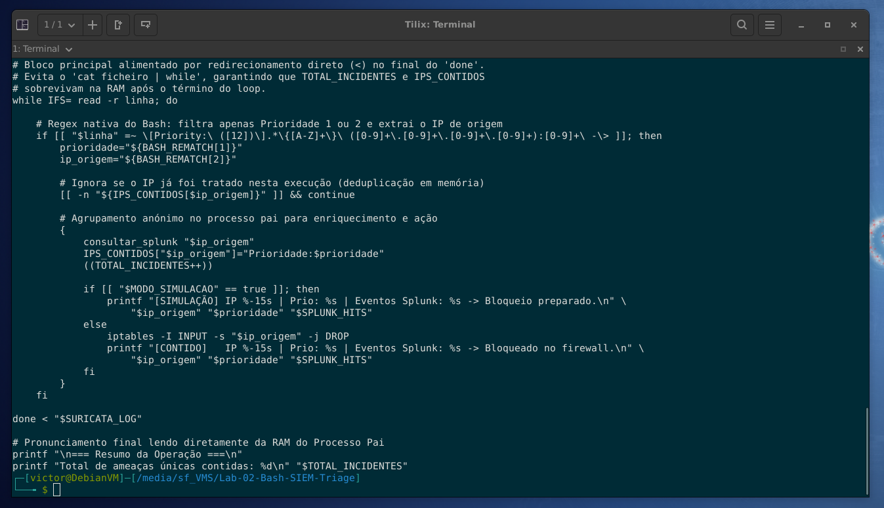
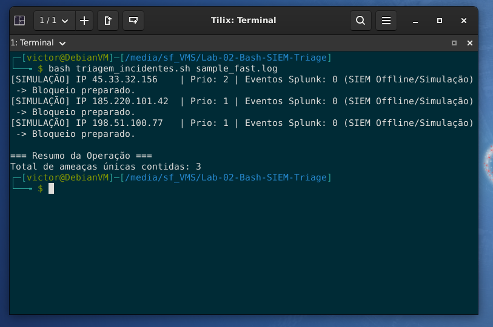
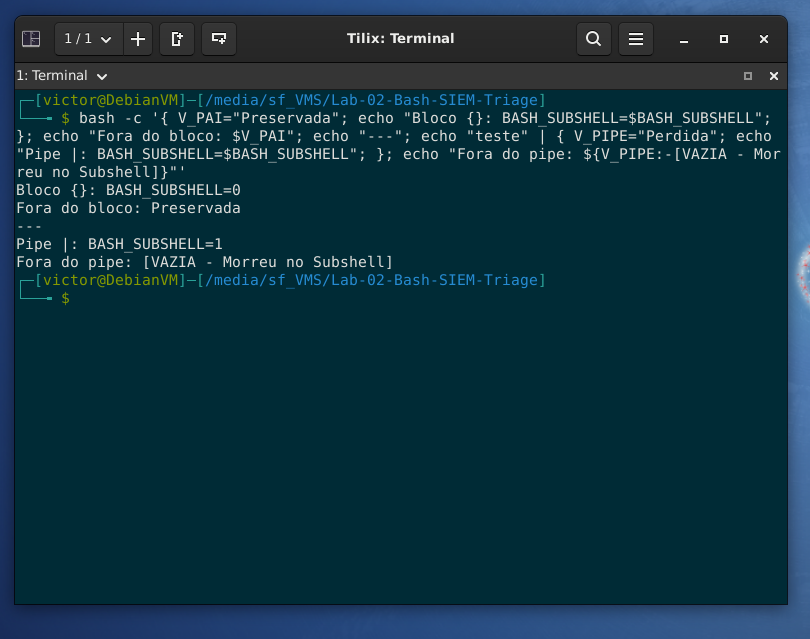

#Português

Relatório Técnico: Engenharia de Automação Blue Team — Triagem de Alertas Suricata e Correlação Splunk (SPL) em Bash Puro

1. Reconhecimento do Ambiente e Arquitetura de Execução

Antes de desenvolver o motor de automação em ambiente Linux (`Debian 13`), realizou-se a validação da versão do interpretador `Bash` e da hierarquia de processos do terminal. Esta etapa é crítica em engenharia de Shell para garantir suporte nativo a *arrays* associativos (`declare -A`), expressões regulares internas (`BASH_REMATCH`) e controle de escopo de memória entre o processo pai e processos filhos (*subshells*).
* Interpretador `Bash`: Selecionado como *runtime* padrão (`#!/bin/bash`) para assegurar portabilidade nativa em servidores Linux corporativos sem dependências externas.
* Controle de Geração (`$BASH_SUBSHELL`): Validado no nível `0` (processo pai original), estabelecendo a linha de base para evitar a perda de variáveis de estado na memória RAM durante ciclos de leitura de logs.
* Decisão Operacional: O fluxo de ingestão de dados foi projetado estritamente com redirecionamento direto (`<`) e agrupamento anônimo (`{ ... }`), eliminando o uso de encadeamentos via *pipe* (`|`) que forçam a criação de *subshells* isolados.

2. Escopo da Simulação

Este exercício documenta o desenvolvimento e a validação de um orquestrador leve de Resposta a Incidentes (SOAR/Blue Team) em **Bash puro**. O objetivo é demonstrar a capacidade de ingerir telemetria de alertas de rede (`Suricata`), realizar triagem e deduplicação de Indicadores de Compromisso (IoCs) diretamente na memória, consultar histórico via API REST de SIEM (`Splunk` / `SPL`) e preparar regras de contenção automatizada no firewall do kernel (`iptables`).

3. Topologia e Ferramentas

* Ambiente: `Debian 13` (Virtual Machine)
* Interpretador / Linguagem: `GNU Bash` (Puro, sem utilitários externos de *parsing*)
* Ecossistema Integrado: `Suricata` (NIDS), `Splunk Enterprise` (API REST / SPL), `cURL` e `iptables` (Netfilter).

4. Preparação da Telemetria Simulada (`sample_fast.log`)

Para validar o comportamento analítico do orquestrador de forma reproduzível e auditável, estruturou-se uma massa de dados no formato nativo `fast.log` do Suricata contendo cinco eventos distintos:
* 1. Eventos de alta severidade (`Priority: 1` e `Priority: 2`) simulando varredura em porta MSSQL (`45.33.32.156`), exploração de SQL Injection (`185.220.101.42`) e comunicação C2 CobaltStrike (`198.51.100.77`).
* 2. Evento duplicado originado do endereço `185.220.101.42` para validar a eficácia da deduplicação em memória e impedir regras redundantes no firewall.
* 3. Tráfego informativo de baixa severidade (`Priority: 3` / `ICMP`) originado de `10.0.2.2`, inserido como ruído de controle para confirmar o descarte automático pela expressão regular.

5. Engenharia do Motor de Triagem (`triagem_incidentes.sh`)

O núcleo lógico do script foi construído aplicando práticas de otimização de memória e CPU para operar sob alta carga sem gerar múltiplos *forks* de sistema operacional.
* Arquivo principal: `triagem_incidentes.sh`
* Extração Nativa (`BASH_REMATCH`): A expressão regular `\[Priority:\ ([12])\].*\{[A-Z]+\}\ ([0-9]+\.[0-9]+\.[0-9]+\.[0-9]+):[0-9]+\ -\>` filtra exclusivamente alertas críticos/altos e captura a prioridade e o endereço IP de origem diretamente na RAM, dispensando invocações externas a `grep`, `awk`, `sed` ou `cut`.
* Deduplicação em Tempo Constante: O *array* associativo `IPS_CONTIDOS` indexa cada endereço IP tratado, ignorando ocorrências subsequentes na mesma execução.
* Manipulação Nativa de Strings e Contenção Segura: A resposta CSV da API do Splunk tem o cabeçalho removido via expansão de parâmetros (`${resposta_raw#*$'\n'}`), e a flag `MODO_SIMULACAO=true` garante auditoria (*dry-run*) antes de injetar regras `DROP` na *chain* `INPUT` do `iptables`.

6. Processamento e Análise de Resultados

O orquestrador foi executado contra o arquivo `sample_fast.log` com o serviço do Splunk inativo no *snapshot*, validando tanto a triagem quanto a resiliência do tratamento de falhas de rede.

   6.1. Validação da Triagem e Resiliência SIEM

A execução confirmou o processamento exato de 3 ameaças únicas (`45.33.32.156`, `185.220.101.42` e `198.51.100.77`). O segundo evento de `185.220.101.42` foi suprimido pela tabela *hash* em memória, o pacote `ICMP` de `Priority: 3` foi descartado na triagem e a indisponibilidade da API do Splunk foi tratada de forma graciosa (`0 (SIEM Offline/Simulação)`), preservando o contador final (`Total de ameaças únicas contidas: 3`) fora do ciclo de leitura.

   6.2. Prova de Conceito: Escopo de Memória Pai vs. Subshell (`$BASH_SUBSHELL`)

Para comprovar empiricamente a decisão arquitetural descrita na Seção 1, executou-se um teste comparativo isolando a variável de contador do kernel (`$BASH_SUBSHELL`):
* Bloco Agrupado (`{ ... }`): Executado no nível `0` (processo pai). A variável `V_PAI` permaneceu acessível e íntegra na memória após o encerramento do bloco.
* Encadeamento via Pipe (`|`): Executado no nível `1` (*subshell* filho). A variável `V_PIPE` foi destruída pelo kernel assim que o processo filho encerrou, retornando vazia no processo pai.

7. Conclusão

O laboratório demonstrou com êxito a eficiência do Shell Script nativo como camada de orquestração tática em operações de Blue Team. O fluxo comprova que a combinação de redirecionamentos diretos, expressões regulares internas e manipulação nativa de variáveis elimina gargalos de processo no Linux, entregando uma automação resiliente, auditável e pronta para integração entre NIDS, SIEM e firewall.

---

#English

Technical Report: Blue Team Automation Engineering — Suricata Alert Triaging and Splunk (SPL) Correlation in Pure Bash

1. Environment Reconnaissance and Execution Architecture

Prior to developing the automation engine within a Linux environment (`Debian 13`), a verification of the `Bash` interpreter version and terminal process hierarchy was conducted. This step is critical in Shell engineering to guarantee native support for associative arrays (`declare -A`), built-in regular expressions (`BASH_REMATCH`), and memory scope control between parent and child processes (*subshells*).
* `Bash` Interpreter: Selected as the standard runtime (`#!/bin/bash`) to ensure native portability across enterprise Linux servers without external dependencies.
* Generation Tracking (`$BASH_SUBSHELL`): Validated at level `0` (original parent process), establishing the baseline to prevent state variable loss in RAM during log ingestion loops.
* Operational Decision: The data ingestion pipeline was strictly engineered using direct input redirection (`<`) and anonymous command grouping (`{ ... }`), eliminating *pipe* chains (`|`) that force the creation of isolated *subshells*.

2. Scope of the Simulation

This exercise documents the engineering and validation of a lightweight Incident Response (SOAR/Blue Team) orchestrator written in **pure Bash**. The primary objective is to demonstrate the capability to ingest network alert telemetry (`Suricata`), perform Indicator of Compromise (IoC) triaging and deduplication directly in memory, query historical event counts via a SIEM REST API (`Splunk` / `SPL`), and stage automated containment rules on the Linux kernel firewall (`iptables`).

3. Topology and Stack

* Environment: `Debian 13` (Virtual Machine)
* Interpreter / Language: `GNU Bash` (Pure built-ins, zero external parsing utilities)
* Integrated Stack: `Suricata` (NIDS), `Splunk Enterprise` (REST API / SPL), `cURL`, and `iptables` (Netfilter).

4. Simulated Telemetry Preparation (`sample_fast.log`)

To validate the orchestrator's analytical behavior in a reproducible and auditable manner, a dataset formatted after Suricata's native `fast.log` was structured with five distinct events:
* 1. High-severity events (`Priority: 1` and `Priority: 2`) simulating an MSSQL port scan (`45.33.32.156`), an SQL Injection exploit attempt (`185.220.101.42`), and CobaltStrike C2 beacon traffic (`198.51.100.77`).
* 2. A duplicate alert originating from `185.220.101.42` to validate in-memory deduplication and prevent redundant firewall rule insertion.
* 3. Low-severity informational traffic (`Priority: 3` / `ICMP`) from `10.0.2.2`, injected as control noise to verify automatic filtering by the regular expression.

5. Triaging Engine Engineering (`triagem_incidentes.sh`)

The core logic of the script was built around CPU and memory optimization practices to operate under heavy alert loads without spawning excessive operating system *forks*.
* Primary Script: `triagem_incidentes.sh`
* Native Extraction (`BASH_REMATCH`): The regular expression `\[Priority:\ ([12])\].*\{[A-Z]+\}\ ([0-9]+\.[0-9]+\.[0-9]+\.[0-9]+):[0-9]+\ -\>` filters exclusively critical/high alerts and captures both severity priority and source IP directly in RAM, eliminating external calls to `grep`, `awk`, `sed`, or `cut`.
* Constant-Time Deduplication: The associative array `IPS_CONTIDOS` indexes each processed IP address, skipping subsequent occurrences within the same execution cycle.
* Native String Manipulation and Safe Containment: The CSV payload returned by the Splunk API has its header stripped via parameter expansion (`${resposta_raw#*$'\n'}`), while the `MODO_SIMULACAO=true` flag enforces dry-run auditing before inserting `DROP` rules into the `iptables` `INPUT` chain.

6. Processing and Analytical Results

The orchestrator was executed against `sample_fast.log` with the Splunk service inactive in the snapshot, validating both alert triaging and graceful network fault handling.

   6.1. Triaging Validation and SIEM Resilience

Execution confirmed the exact processing of 3 unique threats (`45.33.32.156`, `185.220.101.42`, and `198.51.100.77`). The duplicate event from `185.220.101.42` was suppressed by the in-memory hash table, the `Priority: 3` `ICMP` packet was discarded during triaging, and the unreachable Splunk API was handled gracefully (`0 (SIEM Offline/Simulação)`), preserving the final counter (`Total de ameaças únicas contidas: 3`) outside the read loop.

   6.2. Proof of Concept: Parent vs. Subshell Memory Scope (`$BASH_SUBSHELL`)

To empirically validate the architectural decision detailed in Section 1, a comparative test was executed inspecting the kernel's subshell depth counter (`$BASH_SUBSHELL`):
* Grouped Block (`{ ... }`): Executed at depth `0` (parent process). The `V_PAI` variable remained intact and accessible in memory after block termination.
* Pipe Chain (`|`): Executed at depth `1` (child *subshell*). The `V_PIPE` variable was destroyed by the kernel upon child process termination, evaluating as empty in the parent shell.

7. Conclusion

The laboratory experiment successfully demonstrated the efficiency of native Shell scripting as a tactical orchestration layer in Blue Team operations. The workflow proves that combining direct input redirections, built-in regular expressions, and native variable scoping eliminates process bottlenecks on Linux, delivering a resilient, auditable automation pipeline ready to bridge NIDS, SIEM, and host firewall layers.
